# Beach Bloom

**Morten Sylvest · 2025 · Fine art print, 80 × 80 cm, edition of 1**

Beach Bloom is a semi-automated art system that turns stones from a Danish beach into an endless series of one-of-a-kind digital artworks. Stones are collected, 3D-scanned, 3D-printed as drawings and then run through AI image diffusion. A human curates every image before it reaches the shop.

This repo is a reference project for **using video and AI imagery to tell the story of a process**: from landscape, to material, to machine, to image.

🔗 Original project page: [mortensylvest.studio](https://mortensylvest.studio/) → Outputs → Beach Bloom

---

## The reel

[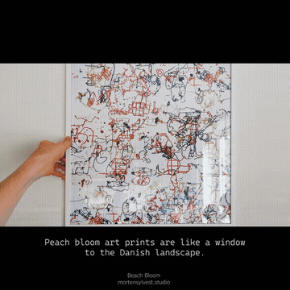](media/video/beach-bloom-reel-1.mp4)

▶️ **[Watch the full reel (MP4, 73 s, 1080×1080, with voice)](media/video/beach-bloom-reel-1.mp4)**

### How the reel was made

The reel is where AI moves from the artwork into the storytelling. It combines real footage with AI-generated shots:

1. **Landscape footage.** Shots filmed at the mining site and in the studio.
2. **AI stills.** Images generated with **Nano Banana** (Google's Gemini image model) to create frames that connect the real material to the AI outputs.
3. **AI video, start frame → end frame.** Clips generated with **Google Veo**, giving it a start frame and an end frame and letting the model create the motion between them. This makes it possible to animate a transformation from one image to another.
4. **Edit.** Real footage and AI clips cut together in **Adobe Premiere Pro**, with voice-over.

**Why start → end frames matter for storytelling:** the process is a chain of transformations, and start/end-frame generation lets each cut *show* a transformation instead of only pointing to it. You pick two states of the material, and the model fills in what happens between them.

---

## The story in 13 steps

The process is told as a chain: each step's output becomes the next step's raw material.

### I. Landscape

| | |
|---|---|
| 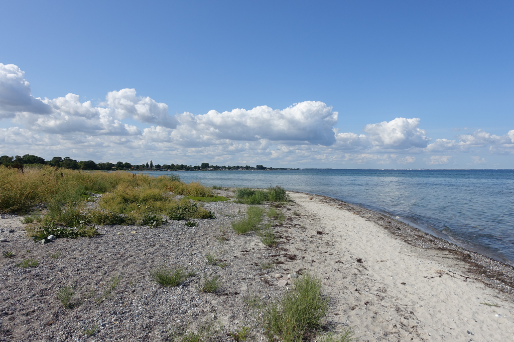 | **01 · Landscape research.** Looking for a good mining site. |
| 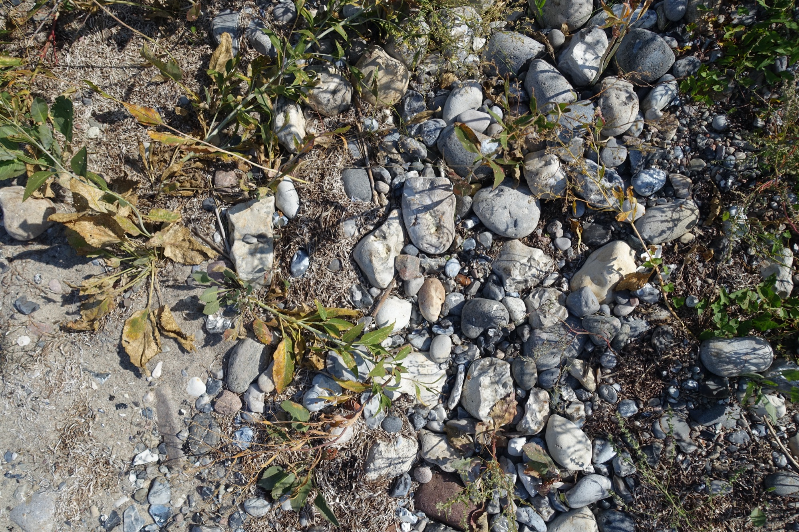 | **02 · Mining site.** A mining site is found at Strøby Egede (55.4003, 12.3135). Material extraction can begin. |
| 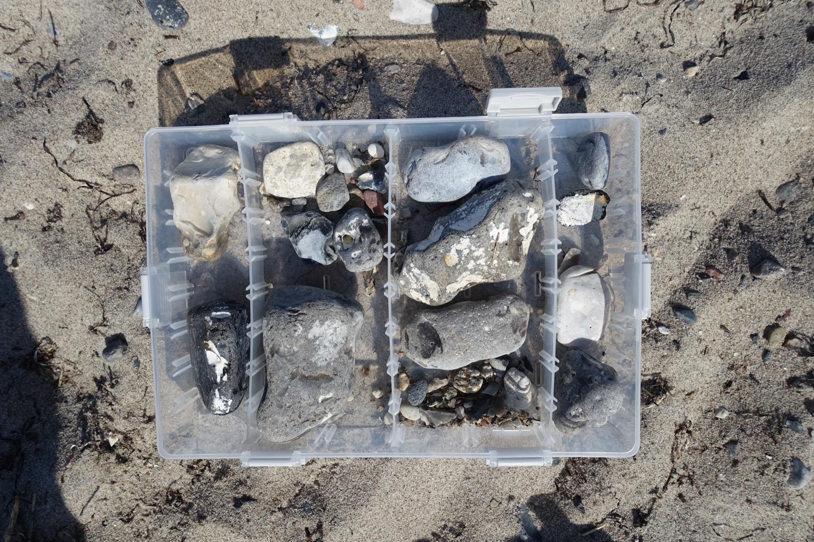 | **03 · Raw material collection.** Stones are collected and sorted on the beach. |

### II. Material → digital

| | |
|---|---|
| 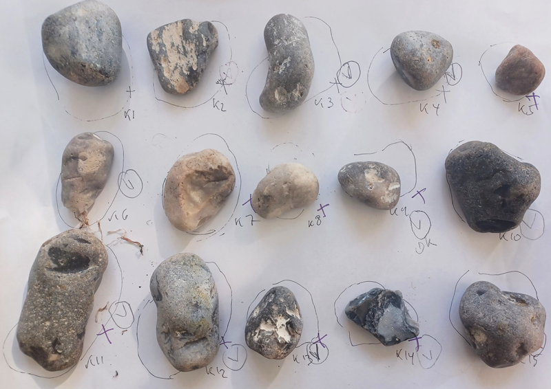 | **04 · Digitalising materials.** Selected stones are numbered and prepared for scanning. |
| 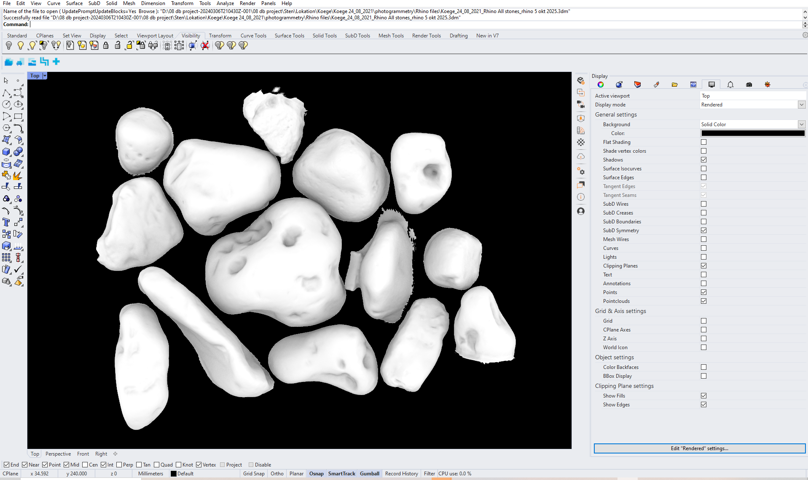 | **05 · Digital cloning.** Each stone is captured with photogrammetry and becomes a 3D object. |
| 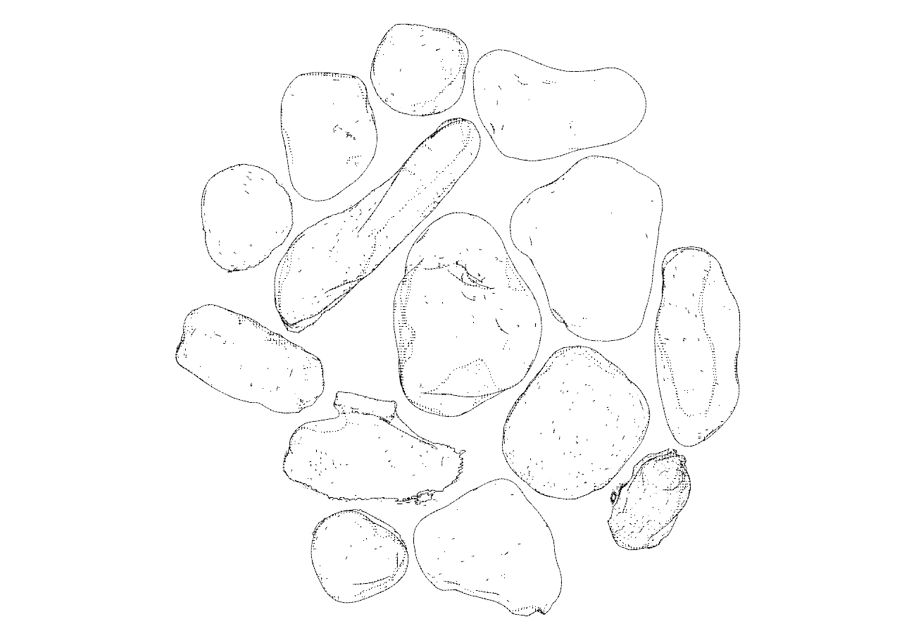 | **06 · Preparing files.** The digital stones are prepared for 3D printing. |
| 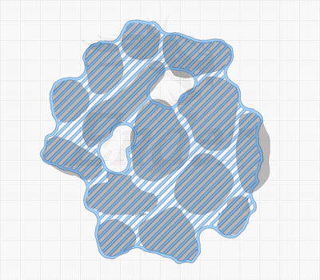 | **07 · Slicing.** The 3D files are processed in a slicer, ready to print. |
| 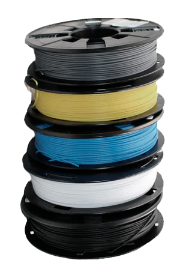 | **08 · New materials.** Standard PLA colours are chosen to print the cloned stones. |

### III. Machine + body

| | |
|---|---|
| 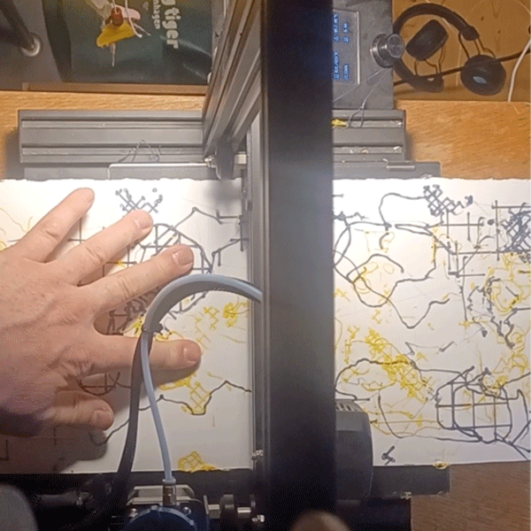 | **09 · Hand drawing.** The printer runs the print file while paper (100 × 20 cm) is moved by hand underneath. Machine and body make the drawing together: wave-worn textures, printer infill patterns and machine paths that look like crop fields. |
| 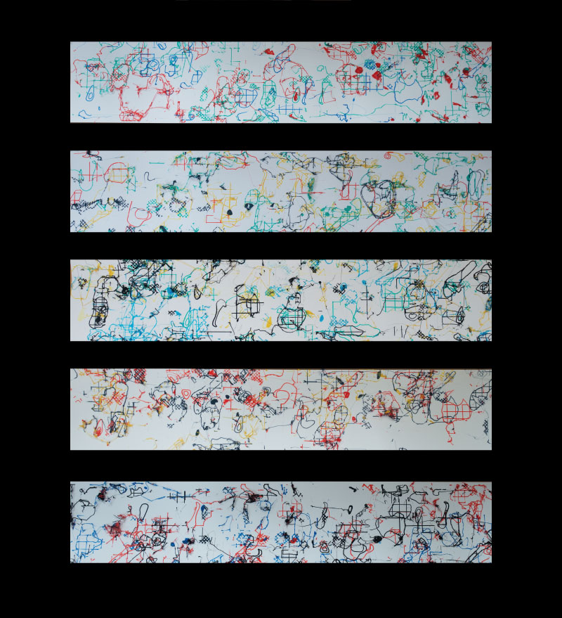 | **10 · Blueprints.** Five blueprint drawings are made. |
| 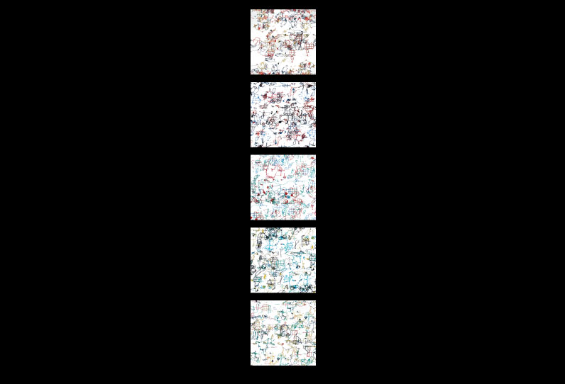 | **11 · Digital blueprints.** The physical prints are photographed and edited into five 50 × 50 digital blueprints. |

### IV. AI + curation

| | |
|---|---|
| 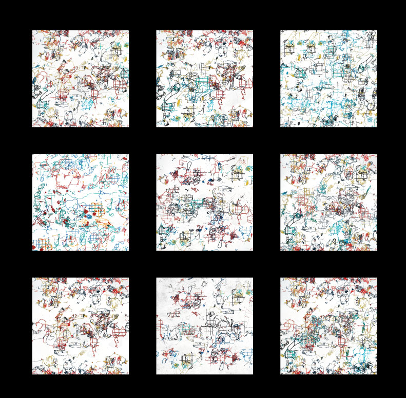 | **12 · Batch 001.** The blueprints are fed into AI diffusion models (fal.ai). They come back in batches of 50–100 variations, like sets of waves: each one unique, all related. These are 9 samples from the first batch of 50. |
| 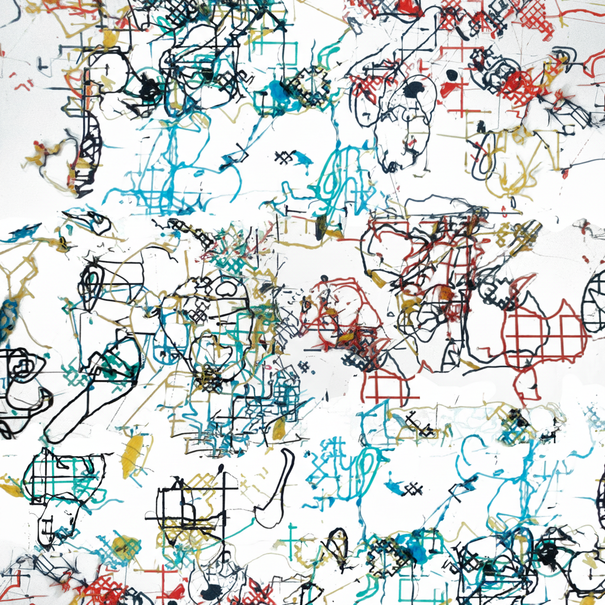 | **13 · Output.** The first approved output of the diffusion wave. |

### V. The cycle

Every generated image is reviewed, and only approved ones go on to the shop. The shop always has exactly **16** artworks for sale. When one sells, a webhook pulls the next approved image from the curated batch and turns it into a new product. Then the cycle starts again.

---

## Storytelling notes (for reuse)

What makes this project work as a reference for video and process storytelling:

- **Start with the body in a place.** The story opens in a real landscape at real coordinates before anything digital happens.
- **Each step is a material transformation:** stone → scan → print → drawing → blueprint → AI image. The audience can follow one thing changing form.
- **Short motion clips for machine steps.** GIFs of the slicer and the printer show process better than stills do.
- **The batch shows the system.** A grid of 9 variations explains "infinite but related" faster than any text.
- **The reel compresses the whole chain** into 73 seconds with voice-over, for social media and exhibitions.
- **End with a loop, not a finish.** The automated shop cycle shows the work as an ongoing system rather than a single object.

---

## Repo structure

```
media/
  process/   01–11  landscape → material → machine → blueprint
  output/    12–13  AI diffusion batch and first output
  video/     reel (web-optimised MP4), poster frame, preview GIF
```

The video is a web-optimised version (H.264, CRF 25, ~14 MB) of the 96 MB master. The master isn't stored in this repo.

## Credits

Concept, process and photos: Morten Sylvest Nøhr (msn). AI generation via [fal.ai](https://fal.ai).
© Morten Sylvest. All rights reserved. Images and video may not be reused without permission.
